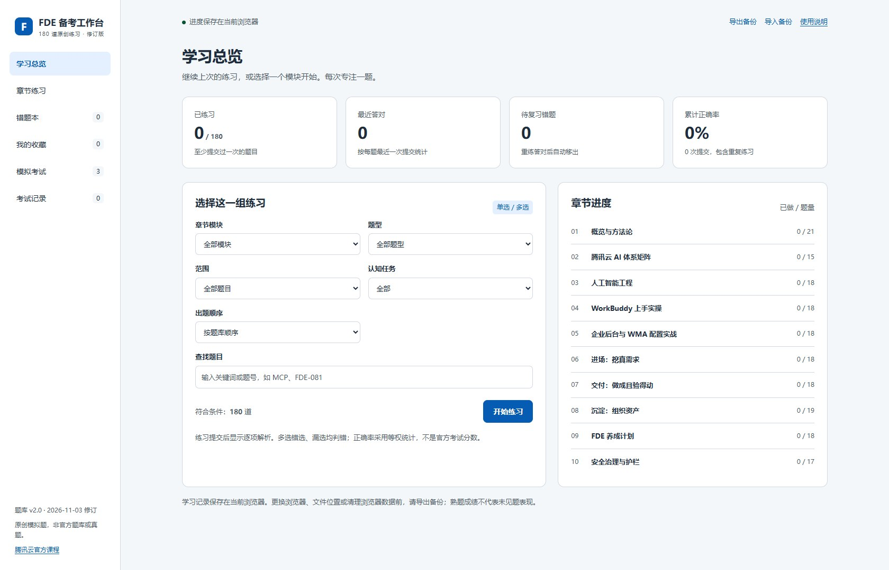
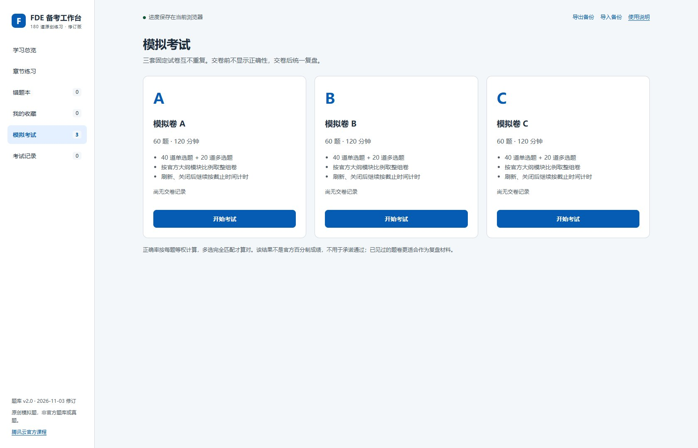
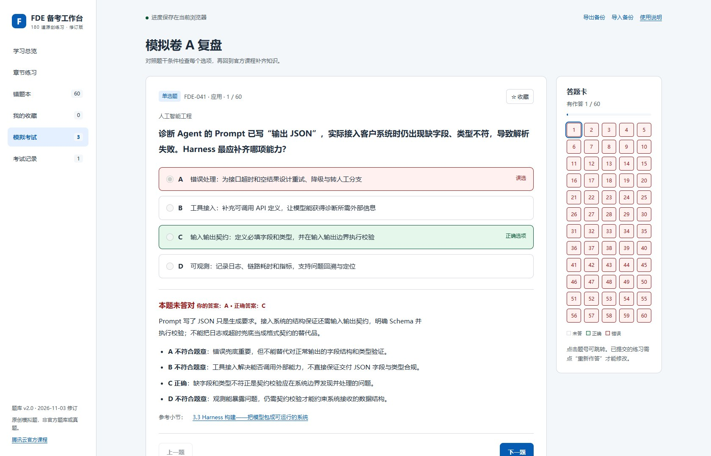

# 腾讯云人工智能前沿部署工程师（FDE）认证考试模拟题 · 个人备考总结

这是我备考腾讯云 FDE 认证（CID）时整理的个人总结和原创模拟题。题库 v2.0 包含 **180 道题、逐项解析、错题本和三套限时模拟卷**，供个人备考参考。考试要求以[腾讯云官方考试指南](https://cloud.tencent.com/document/product/658/139487?lang=zh)为准。

## 开始刷题

- **离线练习：** 在仓库首页点击 **Code → Download ZIP**，完整解压后，用 Chrome、Edge 等浏览器打开 [FDE_180题_离线练习.html](FDE_180题_离线练习.html)。网页已经内置题库，打开即可做题。
- **在线练习：** 打开 [FDE 在线刷题](https://yimwu.github.io/tencent-fde-practice/) 进入工作台。
- **按章节练习：** 在「学习总览」选择模块、题型或范围，点击「开始练习」。提交答案后可以查看逐项解析，并按参考小节回查腾讯云官方课程。
- **限时模拟：** 从侧栏进入「模拟考试」，选 A、B 或 C 卷，点击「开始考试」并确认。

题目、计时和判分都在浏览器中运行。打开官方课程链接需要联网，可能需要登录。更多操作见[使用说明](使用说明.html)。

## 我的备考经验

我按下面的流程备考，最终以 **95 分**通过腾讯云 FDE 正式考试：

1. **完整学一遍官网课程。** 从[腾讯云 FDE 官方课程第一章](https://cloud.tencent.com/edu/learning/course-4767-84813-84825)进入，登录后按目录学习，先理解 FDE 的工作流程和课程重点。
2. **刷完 180 道题。** 对照逐项解析复盘错题，回到参考小节弄清为什么选错或漏选。
3. **限时完成 A、B、C 三套卷。** 我把每套正确率达到 **90%** 作为考前自测目标，三套都达标后参加了正式考试。

三套卷使用同一套 180 题。刷完题库再做模拟卷，主要用来复盘知识点和练习答题节奏。90% 是我的个人备考参考。

## 模拟考试

- 每卷 **60 题**，含 40 道单选和 20 道多选，限时 **120 分钟**。三套卷之间的题目互不重复。
- 确认开考后开始计时。刷新或关闭页面时，截止时间照常计算。交卷后可查看分模块表现、逐题复盘或只看错题。
- 页面按每题等权计算正确率。多选题须选全且无错选才得分。页面正确率与官方考试分数采用不同口径。

| 材料 | 入口 |
| --- | --- |
| 180 题文档 | [练习版](FDE_180题_练习版.md) · [答案解析](FDE_180题_答案解析.md) |
| 模拟卷 A | [试题](模拟卷/模拟卷A_试题.md) · [答案解析](模拟卷/模拟卷A_答案解析.md) |
| 模拟卷 B | [试题](模拟卷/模拟卷B_试题.md) · [答案解析](模拟卷/模拟卷B_答案解析.md) |
| 模拟卷 C | [试题](模拟卷/模拟卷C_试题.md) · [答案解析](模拟卷/模拟卷C_答案解析.md) |
| 纸笔自测 | [空白答题卡](模拟卷/空白答题卡.md) |

## 界面截图

### 学习总览

按模块、题型和范围筛选题目，查看各模块的练习进度。

### 模拟考试

在这里选择 A、B 或 C 卷。

### 交卷复盘

对照自己的选择和正确答案，查看逐项解析。截图使用演示作答。

## 保存和迁移记录

进度、错题、笔记、收藏和模拟考试记录保存在当前浏览器。更换浏览器、移动离线文件或切换在线版前，先点 **导出备份**，再到新页面用 **导入备份** 恢复同一题库版本的学习记录。
